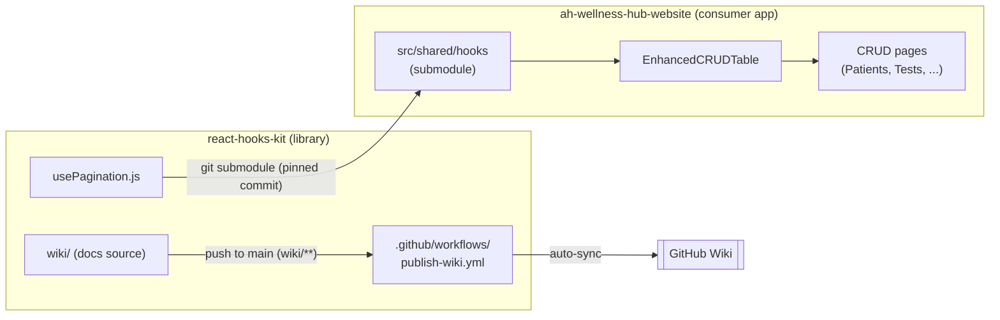
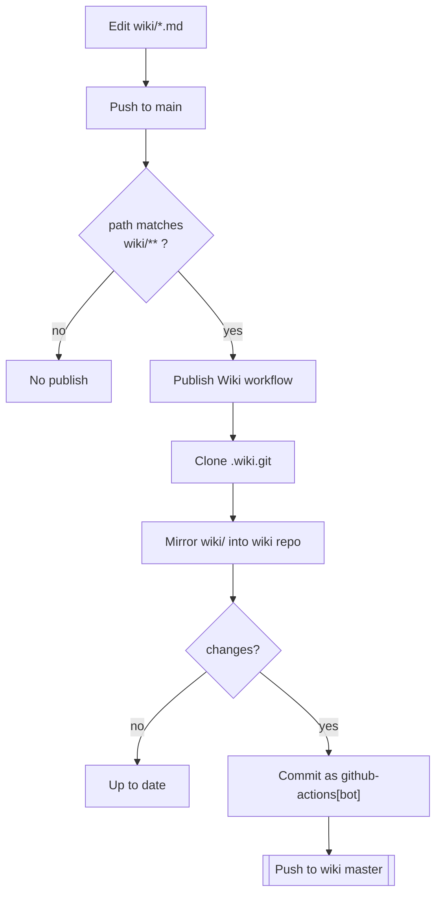
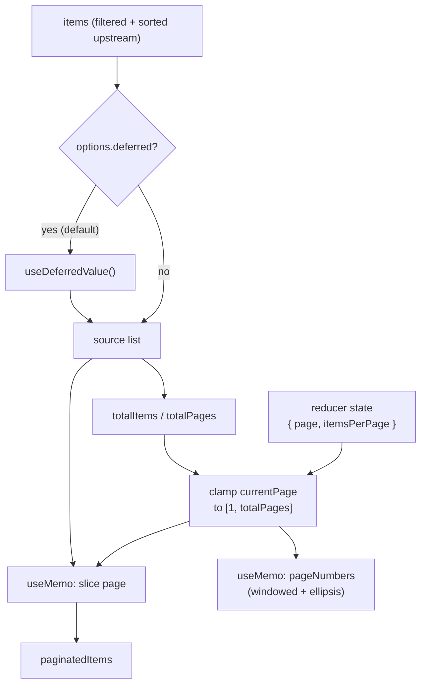

# Architecture

How the kit is organized, how it's consumed, and how the documentation stays in sync.

---

## Consumption — library ⇄ app

`react-hooks-kit` is a standalone library. Apps mount it as a **git submodule** and import hooks directly; there is no build or package step.

- The app **pins** a specific commit of the library (the submodule pointer). It only moves when the app deliberately bumps it.
- `EnhancedCRUDTable` is the single wiring point; every CRUD page inherits pagination through it.

---

## Documentation pipeline

The GitHub Wiki is **generated**, never edited by hand. The `wiki/` folder in the repo is the source of truth.

> Editing the wiki on github.com directly is overwritten on the next publish. Always change `wiki/`.

---

## Hook data pipeline (`usePagination`)

Each hook is self-contained. `usePagination` turns an input array into the current page's slice; filtering and sorting happen **upstream**, in the consumer.

See the full API and more diagrams on the [[usePagination]] page.

---

## See also

- [[usePagination]] — API reference, reducer state machine, sequence diagram
- [[Installation]] — submodule + CI setup
- [[Contributing]] — conventions and the docs rule
