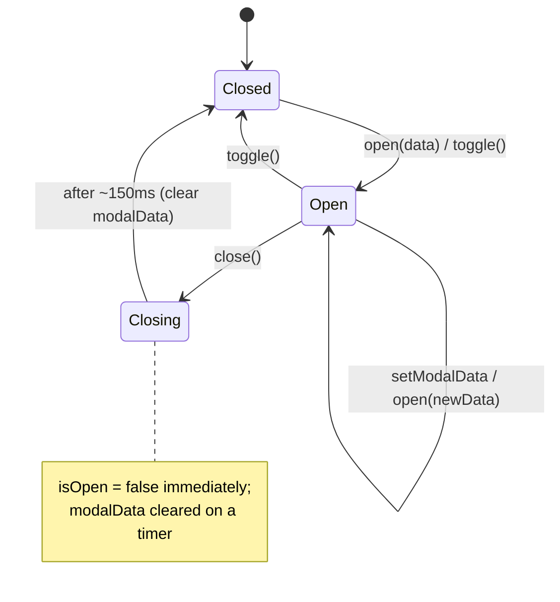

# useModal

Open/close state for a modal (or any dismissible overlay), with an optional data payload carried while it's open — useful for "edit this row" style dialogs.

```js
import { useModal } from './shared/hooks/useModal';
```

---

## Signature

```ts
useModal(initialState?: boolean): ModalResult
```

---

## Parameters

| Parameter | Type | Default | Description |
|-----------|------|---------|-------------|
| `initialState` | `boolean` | `false` | Whether the modal is open on first render. |

---

## Return value

| Key | Type | Description |
|-----|------|-------------|
| `isOpen` | `boolean` | Whether the modal is currently open. |
| `modalData` | `any` | Payload passed to `open(data)`; cleared shortly after `close()`. |
| `open(data?)` | `function` | Open the modal, optionally attaching data (e.g. the record to edit). |
| `close()` | `function` | Close the modal; clears `modalData` after a short delay. |
| `toggle()` | `function` | Flip the open state. |
| `setModalData` | `function` | Update the payload directly. |

---

## Behavior notes

- **Deferred data clear.** On `close()`, `modalData` is cleared after ~150 ms so exit animations can still render the last content instead of flashing empty.
- **Add vs. edit.** `open()` with no argument signals "create"; `open(record)` signals "edit" — check `modalData` to decide.
- **Stable handlers.** `open` / `close` / `toggle` are memoized, so they're safe as props and in dependency arrays.

---

## Recipe — edit dialog driven by data

```js
function Users({ users }) {
  const { isOpen, modalData, open, close } = useModal();

  return (
    <>
      <button onClick={() => open()}>New user</button>

      <ul>
        {users.map((u) => (
          <li key={u.id}>
            {u.name} <button onClick={() => open(u)}>Edit</button>
          </li>
        ))}
      </ul>

      {isOpen && (
        <Dialog onClose={close}>
          <h2>{modalData ? 'Edit user' : 'New user'}</h2>
          <UserForm existing={modalData} onSaved={close} />
        </Dialog>
      )}
    </>
  );
}
```

---

## Internal design

### Lifecycle state machine

`close()` doesn't clear the payload immediately — it waits ~150 ms so exit animations can still render the last content. `toggle()` flips visibility without touching the data.



---

## React primitives used

| Primitive | Role in the hook |
|-----------|------------------|
| `useState` | Open flag and payload data. |
| `useCallback` | Stable `open` / `close` / `toggle` handlers. |

---

## See also

- [[useForm]] — the typical content of a modal
- [[Home]]
