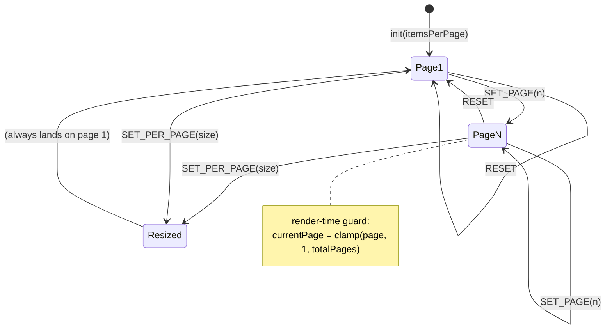
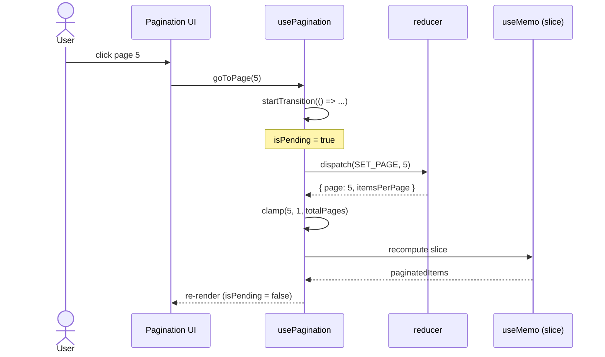

# usePagination

Client-side pagination for an in-memory array. It slices the data for the current page and exposes everything a pagination UI needs — navigation handlers, windowed page numbers with ellipsis, display counters, and concurrent-mode status flags.

Designed to sit **after** filtering and sorting: pass it the already-filtered/sorted array and it handles the paging.

```js
import { usePagination } from './shared/hooks/usePagination';
```

---

## Signature

```ts
usePagination(
  items: Array<T>,
  initialItemsPerPage?: number,   // default: 10
  options?: {
    deferred?: boolean,           // default: true
    maxVisiblePages?: number,     // default: 5
  }
): PaginationResult
```

---

## Parameters

| Parameter | Type | Default | Description |
|-----------|------|---------|-------------|
| `items` | `Array` | `[]` | The full list to paginate. Usually your filtered + sorted data. |
| `initialItemsPerPage` | `number` | `10` | Rows per page on first render. Change later via `changeItemsPerPage`. |
| `options.deferred` | `boolean` | `true` | Wrap the source list in `useDeferredValue` so rapid upstream changes (typing, filtering) don't block painting. The visible slice may lag by one frame under load — exposed via `isStale`. |
| `options.maxVisiblePages` | `number` | `5` | How many numbered buttons to show before collapsing the middle into `'...'`. |

---

## Return value

### Data

| Key | Type | Description |
|-----|------|-------------|
| `paginatedItems` | `Array` | The items for the current page. |
| `totalItems` | `number` | Length of the (deferred) source list. |

### Current state

| Key | Type | Description |
|-----|------|-------------|
| `currentPage` | `number` | Active page (1-based). Auto-clamped if the list shrinks. |
| `itemsPerPage` | `number` | Current page size. |
| `totalPages` | `number` | Total number of pages (minimum `1`). |

### Display helpers

| Key | Type | Description |
|-----|------|-------------|
| `startItem` | `number` | 1-based index of the first item on the page (`0` when empty). |
| `endItem` | `number` | 1-based index of the last item on the page. |
| `pageNumbers` | `Array<number \| '...'>` | Windowed page list for rendering, e.g. `[1, '...', 4, 5, 6, '...', 20]`. |

### Navigation

| Key | Type | Description |
|-----|------|-------------|
| `goToPage(page)` | `(number) => void` | Jump to a page (clamped to valid range). |
| `nextPage()` | `() => void` | Go to the next page if available. |
| `prevPage()` | `() => void` | Go to the previous page if available. |
| `firstPage()` | `() => void` | Jump to page 1. |
| `lastPage()` | `() => void` | Jump to the last page. |

### Settings

| Key | Type | Description |
|-----|------|-------------|
| `changeItemsPerPage(n)` | `(number) => void` | Set a new page size and reset to page 1. |
| `resetPagination()` | `() => void` | Reset to page 1 (e.g. after a new search). |

### Concurrent-mode status

| Key | Type | Description |
|-----|------|-------------|
| `isPending` | `boolean` | A page / page-size change is in flight (via `useTransition`). Use it to dim the table or show a spinner. |
| `isStale` | `boolean` | The visible slice is based on a deferred (slightly outdated) source. Only meaningful when `deferred: true`. |

### Accessibility

| Key | Type | Description |
|-----|------|-------------|
| `paginationId` | `string` | Stable `useId`-generated base id for the control group. |
| `getPageId(page)` | `(number) => string` | Deterministic id for a given page button (handy for `aria-controls` / labelling). |

### Flags

| Key | Type | Description |
|-----|------|-------------|
| `hasNextPage` | `boolean` | `currentPage < totalPages`. |
| `hasPrevPage` | `boolean` | `currentPage > 1`. |
| `isFirstPage` | `boolean` | `currentPage === 1`. |
| `isLastPage` | `boolean` | `currentPage === totalPages`. |

---

## Behavior notes

- **Auto-clamping.** The current page is clamped at render time against `totalPages`. If the list shrinks (e.g. a filter removes results) while you're on a late page, the hook falls back to the last valid page instead of showing an empty view.
- **Page size as a prop.** `initialItemsPerPage` only seeds the first render. If your page size is driven by external config, sync it with an effect:

  ```js
  const { itemsPerPage, changeItemsPerPage } = usePagination(data, size);
  useEffect(() => {
    if (size !== itemsPerPage) changeItemsPerPage(size);
  }, [size, itemsPerPage, changeItemsPerPage]);
  ```
- **Reset on search.** Call `resetPagination()` when the search term changes so the user lands back on page 1.

---

## Recipe — filter → sort → paginate

The hook does paging only. Keep filtering and sorting upstream and feed the result in:

```js
function DataTable({ rows }) {
  const [query, setQuery] = useState('');
  const [sort, setSort] = useState(null);

  const filtered = useMemo(
    () => rows.filter((r) => r.name.toLowerCase().includes(query.toLowerCase())),
    [rows, query]
  );

  const sorted = useMemo(
    () => (sort ? [...filtered].sort(sort) : filtered),
    [filtered, sort]
  );

  const {
    paginatedItems,
    currentPage,
    totalPages,
    pageNumbers,
    startItem,
    endItem,
    totalItems,
    goToPage,
    firstPage,
    prevPage,
    nextPage,
    lastPage,
    resetPagination,
    isPending,
  } = usePagination(sorted, 10);

  // Back to page 1 whenever the query changes
  useEffect(() => { resetPagination(); }, [query, resetPagination]);

  return (
    <div style={{ opacity: isPending ? 0.6 : 1 }}>
      <input value={query} onChange={(e) => setQuery(e.target.value)} placeholder="Search…" />
      <small>{totalItems > 0 ? `${startItem}-${endItem} of ${totalItems}` : 'No results'}</small>

      <table>
        <tbody>
          {paginatedItems.map((row) => (
            <tr key={row.id}><td>{row.name}</td></tr>
          ))}
        </tbody>
      </table>

      {totalPages > 1 && (
        <nav aria-label="Pagination">
          <button onClick={firstPage} disabled={currentPage === 1}>«</button>
          <button onClick={prevPage} disabled={currentPage === 1}>‹</button>
          {pageNumbers.map((p, i) =>
            p === '...'
              ? <span key={`ellipsis-${i}`}>…</span>
              : (
                <button
                  key={p}
                  aria-current={p === currentPage ? 'page' : undefined}
                  onClick={() => goToPage(p)}
                >
                  {p}
                </button>
              )
          )}
          <button onClick={nextPage} disabled={currentPage === totalPages}>›</button>
          <button onClick={lastPage} disabled={currentPage === totalPages}>»</button>
        </nav>
      )}
    </div>
  );
}
```

---

## Internal design

### State machine (reducer)

Page and page size are managed by a single reducer so transitions stay coherent. The current page is additionally **clamped at render time** against `totalPages`, so shrinking the list never leaves you on an empty page.



### Page change — concurrent flow

Navigation is wrapped in `useTransition`, so a page change is a non-urgent update: the UI can keep responding (and expose `isPending`) while React prepares the new slice.



---

## React primitives used

| Primitive | Role in the hook |
|-----------|------------------|
| `useReducer` | Coherent transitions for `page` + `itemsPerPage`. |
| `useDeferredValue` | Keeps input/filtering responsive on large lists (`isStale`). |
| `useTransition` | Marks page / page-size changes as non-urgent (`isPending`). |
| `useId` | Stable, SSR-safe ids for accessible controls. |
| `useMemo` / `useCallback` | Memoized slice, page-number window, and stable handlers. |

---

## See also

- [[Installation]]
- [[Home]]
